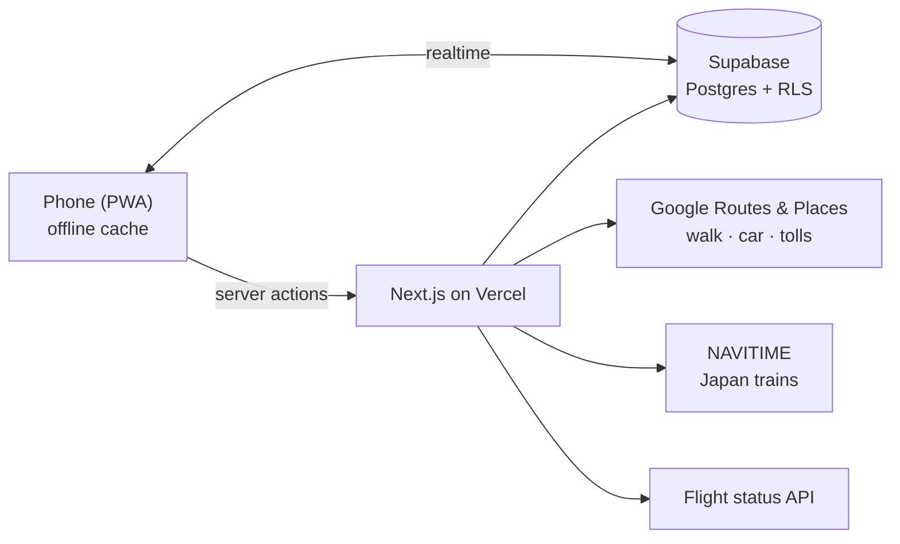

# Travel Buddy

**One shared place for a group trip.** Flights, the day-by-day plan, stays, bookings and guide notes, on everyone's phone, even offline.

**Live:** [travel-buddy.amjadrushdan.com](https://travel-buddy.amjadrushdan.com)

Built for a family trip to Japan. Nobody has to sign up: open the invite link, type your name, and you're in.

---

## What it does

| Section | What you get |
|---|---|
| **Home** | Cover photo, countdown, the next flight as a boarding pass, today's stops and a currency converter. |
| **Flights** | Every flight in the trip with live status: gate, terminal, delays. |
| **Plan** | Day by day, with weather and day names. Routes between stops are worked out for you (see below). |
| **Stay** | Addresses, check-in times and instructions, and a to-do list for each stay. |
| **Bookings & docs** | Tickets, reservations and documents, all in one place. |
| **Guide** | Shared notes: food, sights, tips. |
| **Food scanner** | Scan a Japanese snack's barcode or ingredients label to flag pork, gelatin, alcohol and more. |
| **Members** | Invite links with roles: owner, editor or viewer. |

### Routes on the Plan

Between each pair of stops, the plan shows how to get there and when to leave:

- **Walk**, **train**, **car** or **flight**, picked automatically. A short walk stays a walk, a train is used when it's quicker, and two airports far apart are a flight.
- **Japanese trains** come with English line names, line colours and letters (Ginza Line · G), changes, walks to the platform, and fares.
- **Car days** show driving time and road tolls (ETC rates).
- Each day adds up its **train fares** (per person) and **tolls** (per car).
- One tap opens the route in Google Maps.

### Food scanner

- Reads the barcode in the on-screen box, and looks it up in an offline copy of Open Food Facts' Japanese products (about 2 MB).
- Without ingredients, it reads the Japanese label with on-device OCR.
- It is honest about what it knows. It never says "halal" just because nothing was flagged. It says "No flagged ingredients found" and asks you to look for a halal logo.

## How it's built



- **Next.js 15** (App Router, server actions), **React 19**, **Tailwind CSS 4**
- **Supabase**: Postgres with row-level security on every table, realtime updates, and anonymous sign-in (no passwords; the device is the key)
- **PWA**: installable, with a service worker so the trip can be read offline abroad
- **Scanner**: `BarcodeDetector` (with a fallback) and `tesseract.js` for Japanese OCR, all on the device

### Keeping paid APIs cheap

Every paid lookup goes through one database function that counts calls per day and per month and stops at a cap. On top of that:

- **Saved, not re-asked.** A route is looked up once and saved. Opening the plan costs nothing, and only a changed stop is looked up again.
- **Free first.** Stays and Google Maps links already give exact points, so a place search is only used as a last resort, and its result is saved for the trip.
- **Trains only when they help.** Short walks never ask for trains, and flights ask for nothing.
- **Refresh with a cooldown,** so a route can't be re-checked over and over.
- **Providers behind an adapter.** Japan uses NAVITIME, since Google has no train data there. Other countries can use Google transit without changes to the app.

## Run it locally

Needs Node 20+ and a Supabase project.

```bash
npm install
cp .env.example .env.local   # then fill in the values
npm run dev                  # http://localhost:3000
```

Apply the database migrations in `supabase/migrations` to your project in order (Supabase CLI: `supabase db push`).

| Variable | What for | Needed? |
|---|---|---|
| `NEXT_PUBLIC_SUPABASE_URL` | Supabase project URL | Yes |
| `NEXT_PUBLIC_SUPABASE_ANON_KEY` | Supabase public key | Yes |
| `FLIGHT_STATUS_SECRET` | Lets the server use the API call counter | For flights and routes |
| `FLIGHTAWARE_API_KEY` / `AVIATIONSTACK_API_KEY` | Live flight status | Optional |
| `GOOGLE_MAPS_API_KEY` | Walk and drive times, tolls, place search (Routes + Places APIs) | Optional |
| `RAPIDAPI_KEY` | NAVITIME trains in Japan | Optional |
| `NEXT_PUBLIC_TURNSTILE_SITE_KEY` | Bot check on sign-in | Optional |

Without the optional keys, those features hide themselves and the rest of the app works.

### Scripts

| Command | What it does |
|---|---|
| `npm run dev` | Start the dev server |
| `npm run build` | Production build |
| `npm run lint` | ESLint |
| `npm test` | Food scanner ingredient tests |
| `npm run build:food` | Rebuild the offline Japan food list from the Open Food Facts export |

## Project layout

```
src/
  app/
    trips/[id]/        one folder per tab: plan, flights, stay, bookings, guide, food, members
    join/, welcome/    invite links and first visit
  lib/
    routes/            route providers (Google, NAVITIME), line names, leg rules
    data/              database reads
  components/          shared UI
supabase/migrations/   schema, RLS policies and functions
public/food/jp/        offline food list
scripts/               food list builder, scanner assets
```

## Credits

- Food data: [Open Food Facts](https://world.openfoodfacts.org), under the Open Database Licence (ODbL). The derived list in `public/food/jp` stays under ODbL.
- Train routes in Japan: NAVITIME. Walk, drive and place data: Google Maps Platform.
- The food scanner is a helper, not a halal certification.
